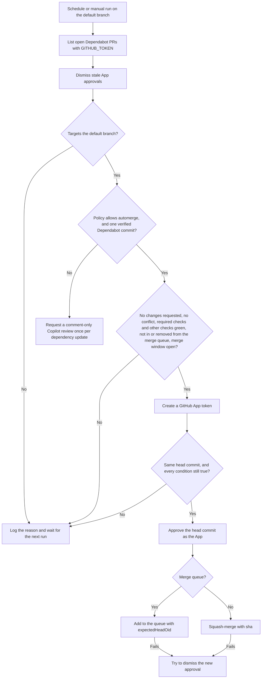

# Dependabot automerge

This document explains how to use `dependabot-automerge-v2.yaml` from `navikt/teamesyfo-github-actions-workflows`, what the consumer repository must configure, and how to migrate from `dependabot-automerge.yaml` (v1).

v1 is deprecated. It runs on `pull_request` with the App key as a Dependabot secret, and it enables auto-merge without binding the approval to a commit. See [Migrate from v1](#migrate-from-v1).

## Quick start

1. Grant the [`teamesyfo-automerge`](https://github.com/apps/teamesyfo-automerge) GitHub App access to the repository.
2. Create the environment `dependabot-automerge` in Settings -> Environments. Under **Deployment branches and tags**, select **Selected branches and tags** and add only the default branch. Do not add required reviewers, a wait timer or a custom deployment protection rule, because the workflow runs on a schedule without a deployment.
3. Test the environment before you add the key. Push a temporary branch with this workflow in `.github/workflows/test-environment.yaml`:

   ```yaml
   name: Test environment
   on: push
   permissions: {}
   jobs:
     test:
       runs-on: ubuntu-latest
       environment:
         name: dependabot-automerge
         deployment: false
       steps:
         - run: echo "This branch can use the environment."
   ```

   GitHub must reject the job because of the environment protection rules. Then delete the branch. If the job runs, every branch can read the App key: fix the environment before you continue.
4. Add the App private key as the **environment secret** `AUTOMERGE_APP_PRIVATE_KEY` in that environment. Do not store the key as a repository secret, an organization secret or a Dependabot secret.
5. Turn off **Allow GitHub Actions to create and approve pull requests** in Settings -> Actions -> General, unless another workflow needs it. The App approves, not `GITHUB_TOKEN`. The default workflow permissions can stay read-only, because the workflow sets its own permissions.
6. Allow squash merging in Settings -> General -> Pull Requests, unless the repository uses a merge queue.
7. Add at least one required status check on the default branch, in a ruleset or in branch protection. The check must come from CI that runs on `pull_request`, and also on `merge_group` with a merge queue. The workflow merges nothing until the required checks have passed on the head commit. Do not add the App to a bypass list in any ruleset or branch protection rule, because GitHub must enforce the required checks when the App merges.
8. Make sure that a Copilot approval cannot count as a review. The workflow asks Copilot to review the updates that need a manual review. In Settings -> Copilot -> Code review, under **Auto-approval**, turn off **Allow Copilot to approve pull requests** and **Allow Copilot approvals to count toward merge requirements**. If the organization setting **Count Copilot approvals toward merge requirements** includes the repository, ask an organization owner to exclude it. The workflow cannot check these settings, because GitHub does not make them available through the API. These settings only stop a Copilot approval from counting. A human must approve a pull request only when a ruleset or branch protection requires an approval before merging. `copilot-review: false` in the [caller workflow](#caller-workflow) only stops the review requests from this workflow. It does not change the Copilot settings, and it does not stop Copilot reviews that a ruleset requests.
9. Add the [caller workflow](#caller-workflow).
10. Start the workflow manually on the default branch once, and read the job log.
11. Optional: copy the [Copilot review instructions](#copilot-review-of-manual-updates).

## Policy

| Update | Automerged? | Notes |
| --- | --- | --- |
| GitHub Actions | ✅ Yes | Includes major updates, when the pull request only changes existing workflow and action files |
| Patch or minor update in other ecosystems | ✅ Yes | All updates in a grouped PR must be patch or minor |
| Major update in other ecosystems | ❌ No | Manual review, with an optional Copilot review |
| Other ecosystems without valid Dependabot metadata in the commit | ❌ No | Manual review |

The ecosystem comes from the branch name (`dependabot/<ecosystem>/...`). The update types come from the metadata block that Dependabot adds to its commit message. Every entry in the block must have a name and a version that are not empty or `null`, and no field may occur twice in an entry. Otherwise the patch and minor rule does not apply. A repository can change the branch names that Dependabot uses, so the branch name alone does not prove a GitHub Actions update. When the patch and minor rule does not apply on a GitHub Actions branch, the workflow reads the files that the head commit changes. The update is automerged when every changed file already exists and is either a workflow file directly in `.github/workflows/` or an `action.yml` or `action.yaml` file. This exception does not need the metadata block. It does not apply when GitHub lists the changed files on more than one page, which happens above 300 files. Otherwise the update needs a manual review.

## When the workflow approves and merges

The job runs only on the schedule or on a manual run on the default branch. It has two steps.

**1. Find the pull requests that are ready (`GITHUB_TOKEN`).** The workflow checks every open Dependabot pull request. A pull request is ready to merge only when all of these conditions are true:

- `dependabot[bot]` opened it from a `dependabot/` branch in the same repository.
- It targets the default branch.
- It follows the [policy](#policy) and is not a draft.
- It has exactly one commit. That commit is the head of the pull request, Dependabot wrote it, GitHub committed it, and GitHub verified its signature. If anyone else pushes to the branch, the pull request needs a manual review.
- No reviewer's latest review requests changes.
- GitHub reports no merge conflict.
- At least one required status check has reported on the head commit, and every required check that has reported has succeeded, been skipped or concluded neutral. The rulesets and branch protection of the repository decide which checks are required.
- On the head commit, no check run, commit status or workflow run has failed, been cancelled or timed out, none is still running, and at least one has succeeded. Skipped and neutral checks do not count as successful. A cancelled workflow run stops counting when the same workflow has started a newer run for the same event and branch, for example after the pull request was reopened. A newer run does not replace a run that failed or timed out. That run blocks until someone re-runs it and it succeeds.
- It is not in the merge queue, and its head commit has never been in the merge queue. See [Merge queue](#merge-queue).
- The merge window is open. Scheduled runs pause on Saturdays, Sundays, 1 May, 17 May and from 24 December to 1 January (Europe/Oslo). A manual run (`workflow_dispatch`) ignores the merge window.

This step never approves. It dismisses approvals from the App of commits that are no longer the head. It also dismisses every approval from the App on a pull request that no longer targets the default branch, and then skips that pull request. If it cannot dismiss such an approval, it skips the pull request.

**2. Approve and merge (the App).** When at least one pull request is ready, the workflow creates a short-lived token for the GitHub App. For each pull request, it:

1. Checks every condition again with fresh data, for the same head commit. If something has changed, it skips the pull request.
2. Approves exactly the head commit as `teamesyfo-automerge[bot]`. This approval counts as the required review.
3. Merges the approved commit:
   - With a merge queue, it adds the pull request to the queue with `expectedHeadOid`, so GitHub rejects it if the head has changed.
   - Without a merge queue, it squash-merges with the `sha` of the approved commit, so GitHub rejects the merge if the head has changed.

If the merge fails, the workflow tries to dismiss the new approval, the job log shows a warning, and the next run tries again. If the dismissal also fails, the approval stays until someone dismisses it (see [Troubleshooting](#troubleshooting)). The workflow does not fall back to another merge method, and it never checks out or runs code from a pull request.



## Caller workflow

Create `.github/workflows/dependabot-automerge.yaml` on the default branch:

```yaml
name: Dependabot automerge

on:
  schedule:
    # Every 30 minutes on weekdays, 07:00–15:30 in Oslo.
    - cron: "*/30 7-15 * * 1-5"
      timezone: "Europe/Oslo"
  workflow_dispatch:

permissions: {}

jobs:
  automerge:
    permissions:
      actions: read
      checks: read
      contents: read
      pull-requests: write
      statuses: read
    uses: navikt/teamesyfo-github-actions-workflows/.github/workflows/dependabot-automerge-v2.yaml@<full commit SHA> # main
    secrets:
      AUTOMERGE_APP_PRIVATE_KEY: ${{ secrets.AUTOMERGE_APP_PRIVATE_KEY }}
```

- Pin the workflow to a full commit SHA. The workflow uses the App key, so a change on `main` in this repository should not reach your repository before you update the pin.
- Add the caller only after you have created and tested the environment (steps 2–4 in the [quick start](#quick-start)). If the environment does not exist when the workflow runs, GitHub creates it without protection rules.
- The caller must pass the secret by name, although the secret only exists in the environment. The environment secret takes precedence.
- To turn off the Copilot review, add `with: copilot-review: false` to the job.
- Scheduled workflows run only on the default branch. In a public repository, GitHub disables scheduled workflows after 60 days without activity. Enable the workflow again in the Actions tab if that happens.

## Merge queue

A merge queue is recommended. With a merge queue, the required CI workflow must also run on `merge_group`:

```yaml
on:
  pull_request:
  merge_group:
    types: [checks_requested]
```

The App token is needed for the queue, because `GITHUB_TOKEN` cannot add pull requests to a merge queue, and changes from `GITHUB_TOKEN` do not trigger new workflow runs.

GitHub removes a pull request from the queue when the checks in the queue fail or when someone removes it. The checks on the head commit can still be green. The workflow therefore does not add the same commit to the queue again. It waits until the head commit changes, for example after you comment `@dependabot rebase`. You can also add the pull request to the queue by hand. The workflow follows the head commit through the force pushes in the timeline of the pull request, so a commit that has been in the queue cannot return with a force push either. GitHub does not document whether a push removes a pull request from the queue. A commit that is force-pushed while the timeline still shows the pull request in the queue therefore also counts as having been in the queue. A commit that the timeline shows removed from the queue counts as having been in the queue, even when the timeline does not show the addition. The workflow checks this again just before it adds the pull request to the queue. The workflow does not merge the pull request if the timeline has more than 100 merge queue and force-push events, if GitHub does not tell which commit was added to the queue, or if someone has pushed without force after an addition and the workflow therefore cannot tell which commit was added.

One case is not covered, because the timeline does not show the head before the first force push. Suppose someone pushes without force after the pull request was added to the queue and before the first force push, and later force-pushes the added commit back. Then the workflow can add that commit to the queue again. This requires write access to the repository, which also allows adding the pull request to the queue by hand.

The last check and the addition to the queue are two separate requests. GitHub can only make the addition depend on the head commit, not on the queue history. If someone adds the pull request to the queue and it is removed again between the two requests, while the head commit stays the same, the workflow adds the same commit to the queue once more. The queue checks then run again, so the required checks still apply. The cost is an extra run of the queue checks, or that a manual removal is undone once.

Without a merge queue, the workflow merges directly. Then:

- If the branch must be up to date before merging, the merge fails until Dependabot rebases the pull request.
- A pull request that changes files in `.github/workflows/` may need the `workflows` permission, which the App does not have. This has not been verified yet. If the merge fails, the workflow tries to dismiss its approval, the job log shows a warning and the pull request stays open. A merge queue avoids the problem.

## Copilot review of manual updates

For updates that need a manual review, the workflow requests a review from Copilot. This applies to updates that the [policy](#policy) does not allow, such as major updates, and to pull requests where someone other than Dependabot has pushed to the branch. It requests at most one review per dependency update, so a Dependabot rebase or a maintainer's fix on top of the update does not start a new review. For the head commit and for each commit that Copilot has reviewed, the workflow finds the update among the commits that the commit adds to the default branch, also when that commit has left the pull request. The workflow compares the reviewed commits with the same default-branch commit as the head commit. The update is what the commits that Dependabot wrote, GitHub committed and GitHub signed agree on. The versions in their commit messages identify the update. If such a message has no Dependabot metadata, the commit itself identifies the update, so a fix on top does not start a new review, but a rebase does. The workflow treats the update as unknown and requests a new review when these commits disagree, for example after someone merges two Dependabot updates, when GitHub cannot list all of the commits, or when GitHub no longer has a reviewed commit. If the head commit has no such Dependabot commit, the workflow requests a review for each new head commit that Copilot has not reviewed. There is one exception: if someone removes the Copilot review request before Copilot has reviewed, the next run requests the review again. To stop the reviews in a repository, add `with: copilot-review: false` to the caller job. The repository must have access to Copilot code review. Otherwise the job log shows a warning.

Copilot must review with comments only. The Copilot approval settings in step 8 of the [quick start](#quick-start) make sure that a Copilot approval does not count. A human must approve the pull request only when a ruleset or branch protection requires an approval before merging.

To give Copilot the same review rules as other Team eSyfo repositories, copy [`docs/templates/dependency-updates.instructions.md`](templates/dependency-updates.instructions.md) to `.github/instructions/dependency-updates.instructions.md` in the consumer repository. The template asks Copilot to read the upstream release notes, to name what must change in the repository, and never to approve.

## Migrate from v1

1. Do steps 2–8 in the [quick start](#quick-start): create and test the environment, add the environment secret, turn off **Allow GitHub Actions to create and approve pull requests**, add a required status check, and turn off Copilot approvals.
2. Delete the Dependabot secret `AUTOMERGE_APP_PRIVATE_KEY`, and any repository secret that contains the App key. Do this before you add the v2 caller, because the caller would otherwise pass a repository secret to the workflow if the environment secret is missing. Without the secret, v1 stops before it approves anything.
3. On open Dependabot pull requests, turn off the auto-merge that v1 enabled, and dismiss the approvals from `github-actions[bot]`. Do this before you add the v2 caller. v2 dismisses only approvals from the App, so an old approval from v1 still counts as the required review, also for a later commit. Run this from a clone of the repository, as a user who can dismiss reviews:

   ```bash
   for number in $(gh pr list --author app/dependabot --state open --limit 200 --json number --jq '.[].number'); do
     if [ "$(gh pr view "$number" --json autoMergeRequest --jq '.autoMergeRequest != null')" = true ]; then
       gh pr merge --disable-auto "$number"
     fi
     for id in $(gh api --paginate "repos/{owner}/{repo}/pulls/$number/reviews" \
       --jq '.[] | select(.user.login == "github-actions[bot]" and .state == "APPROVED") | .id'); do
       gh api -X PUT "repos/{owner}/{repo}/pulls/$number/reviews/$id/dismissals" \
         -f message="Replaced by Dependabot automerge v2." -f event=DISMISS
     done
   done
   ```

4. Replace the caller workflow with the [v2 caller](#caller-workflow). Remove the `pull_request` trigger.
5. Start the workflow manually on the default branch once, and read the job log.

When all consumer repositories use v2, the team creates a new private key for the App, stores it only in the environments, and revokes the old key. Then `dependabot-automerge.yaml` (v1) can be deleted.

## Security model and remaining risks

- The job that holds the App key never checks out or runs pull request code. The key is only available to the default branch, through the environment, and the job runs only on the schedule or on a manual run on the default branch.
- The first step uses only `GITHUB_TOKEN` and never approves. The workflow creates the App token only when at least one pull request is ready.
- The approval and the merge are bound to the head commit that the workflow checked, and the workflow checks every condition again just before it approves.
- Only an untouched, verified Dependabot commit can be automerged, and only after the required checks of the repository have passed.
- The App approves, not `GITHUB_TOKEN`. With **Allow GitHub Actions to create and approve pull requests** turned off, a workflow on another branch cannot use `GITHUB_TOKEN` to approve a pull request. The App approval counts as the required review, but not as a code owner review.

Remaining risks:

- A malicious version of a dependency that passes CI is still merged. CI, required checks and a Dependabot cooldown reduce this risk.
- Anyone who can push to the default branch can change the caller workflow and use the key, as with other secrets that only the default branch can use.
- If someone pushes to a pull request that the App has approved, the App approval of the old commit still counts until the next run dismisses it. During that time, a human can merge the new commit without a new approval. The same applies when someone changes the base branch of a pull request that the App has approved. If the workflow cannot dismiss the approval, it skips the pull request, and the approval stays until someone dismisses it. **Dismiss stale pull request approvals when new commits are pushed** closes this gap for pushes, but then every push to any pull request needs a new approval. No setting closes the gap for a changed base branch.
- If Copilot approvals can count toward the merge requirements, a Copilot approval of a major update can replace the human review. This applies whether the workflow or a ruleset requests the Copilot review, so `copilot-review: false` does not close this gap. The workflow cannot read these settings. Step 8 in the [quick start](#quick-start) closes this gap.
- If only some people may dismiss reviews in the repository, `GITHUB_TOKEN` may not be allowed to dismiss approvals. Then the workflow skips pull requests with an App approval of an old commit, and a person must dismiss the approval.
- A required check that has not started yet is not visible on the commit. The workflow then evaluates only the required checks that have reported, and relies on GitHub to reject the merge until every required check has passed. This works only when the App cannot bypass the rules. Team eSyfo verifies it once in a test repository: add a required check that never reports, start the workflow manually while a Dependabot pull request is ready, and confirm that GitHub does not merge the pull request. Then remove that check, start the workflow again and confirm that the pull request is merged. The second run shows that the first run was stopped by the required check and not by another error.
- The merge binds to the head commit, but GitHub cannot bind it to the base branch. The workflow checks the base branch just before it approves and again just before it merges. Someone who changes the base branch in the short time between that check and the merge can make the App merge the pull request into another branch. Changing the base branch requires write access to the repository.
- The workflow reads which checks are required with `GITHUB_TOKEN`. This has not been verified in a consumer repository yet. If it does not work, the workflow merges nothing. The log then shows `not ready: no required check has reported`, or, if the lookup fails, `evaluation failed: ...` in the first step or `not merged: ...` in the second step.

## Troubleshooting

The job log has one line for each Dependabot pull request, such as `PR #12: not ready: <reason>`, `PR #12: needs a manual review, because <reason>` or `PR #12: not merged: <reason>`.

| Message or symptom | What to do |
| --- | --- |
| The workflow never runs | Check that the caller workflow is on the default branch, and that GitHub has not disabled the schedule. |
| The job waits for or is rejected by the environment | Check that the environment allows the default branch, and that it has no required reviewers, wait timer or custom deployment protection rule. |
| `The secret AUTOMERGE_APP_PRIVATE_KEY is empty` | Add the key as an environment secret in `dependabot-automerge`. |
| `The App token belongs to "...", but the workflow expects teamesyfo-automerge[bot].` | The secret contains the key of another App. Add the key of `teamesyfo-automerge`. |
| `The merge window is closed. This run merges no pull requests.` or `not ready: the merge window is closed` | Wait for the merge window, or start the workflow manually. |
| `not ready: no required check has reported` | Add a required status check on the default branch, and make sure that CI runs on `pull_request`. See [Security model](#security-model-and-remaining-risks) if the repository already has one. |
| `not ready: required check "..." is failure` | Fix the build, or run the check again. |
| `not ready: no check has succeeded` | Add CI that runs on `pull_request`. |
| `not ready: check "..." concluded cancelled` | Run the check again. |
| `not ready: GitHub has not computed mergeability yet` | Wait for the next run. |
| `not ready: targets ..., not the default branch` | The workflow merges only pull requests to the default branch, and it has dismissed its own approvals on this pull request. Someone has changed the base branch, or `dependabot.yml` sets `target-branch`. Change the base branch back, or review the pull request manually. |
| `not ready: the PR is already in the merge queue` | Wait for the merge queue. |
| `not ready: the head commit was removed from the merge queue; ...` | Find out why GitHub or a person removed the pull request from the queue. Then comment `@dependabot rebase`, or add the pull request to the queue by hand. |
| `not ready: the PR has more than 100 merge queue and force-push events; ...` or `not ready: GitHub does not tell which commit was added to the merge queue; ...` | The workflow cannot tell whether the head commit has been in the queue. Review the pull request, and add it to the queue by hand. |
| `needs a manual review, because the PR has 2 commits, expected 1` or `... the committer is not GitHub` | Someone pushed to the Dependabot branch. Review the pull request manually, or comment `@dependabot recreate`. |
| `not ready: a stale approval could not be dismissed` and `could not dismiss approval ...` | Dismiss the App approval manually. After `not merged: ...`, this is the approval of the current commit. Check whether the repository restricts who can dismiss reviews. |
| `evaluation failed: ...` | Read the error. It can come from a failed lookup of the pull request or its checks. The next run tries again. |
| `not merged: ...` | Check that the App has access to the repository, that squash merging is allowed, and see [Merge queue](#merge-queue). A failed lookup of the required checks also gives this message. The next run tries again. |
| `Skipped an invalid candidate: ...` | This is an error in the workflow. Tell Team eSyfo. |
| `could not request a Copilot review` | Check that the repository has access to Copilot code review, or set `copilot-review: false`. If the message says `could not compare commit ...`, GitHub returned an error when the workflow compared the update with an earlier Copilot review. The workflow requests no review and tries again on the next run. |

## v1 (deprecated)

`dependabot-automerge.yaml` runs on `pull_request`, receives the App key as the secret `APP_PRIVATE_KEY` (callers pass their Dependabot secret `AUTOMERGE_APP_PRIVATE_KEY`), approves eligible pull requests and enables auto-merge with `gh pr merge --auto --squash`. Existing callers keep working until they migrate. Do not use v1 in new setups.
