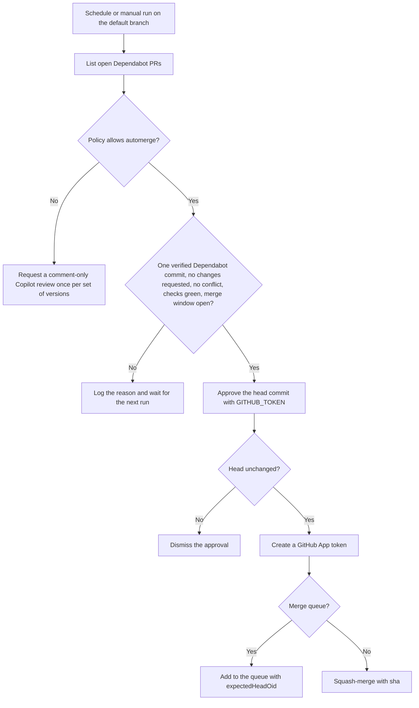

# Dependabot automerge

This document explains how to use `dependabot-automerge-v2.yaml` from `navikt/teamesyfo-github-actions-workflows`, what the consumer repository must configure, and how to migrate from `dependabot-automerge.yaml` (v1).

v1 is deprecated. It runs on `pull_request` with the App key as a Dependabot secret, and it enables auto-merge without binding the approval to a commit. See [Migrate from v1](#migrate-from-v1).

## Quick start

1. Grant the [`teamesyfo-automerge`](https://github.com/apps/teamesyfo-automerge) GitHub App access to the repository.
2. Create the environment `dependabot-automerge` in Settings -> Environments. Under **Deployment branches and tags**, select **Selected branches and tags** and add only the default branch. Do not add required reviewers, because the workflow runs on a schedule.
3. Add the App private key as the **environment secret** `AUTOMERGE_APP_PRIVATE_KEY` in that environment. Do not store the key as a repository secret, an organization secret or a Dependabot secret.
4. Enable **Allow GitHub Actions to create and approve pull requests** in Settings -> Actions -> General. The default workflow permissions can stay read-only, because the workflow sets its own permissions.
5. Allow squash merging in Settings -> General -> Pull Requests, unless the repository uses a merge queue.
6. Make sure that CI runs on `pull_request`, so that every Dependabot PR gets at least one successful check. With a merge queue, CI must also run on `merge_group`.
7. Add the [caller workflow](#caller-workflow).
8. Check the environment: start the workflow manually on a branch other than the default branch. GitHub must reject the job. If the job runs, the environment does not restrict branches, and every branch can read the App key.
9. Optional: copy the [Copilot review instructions](#copilot-review-of-manual-updates).

## Policy

| Update | Automerged? | Notes |
| --- | --- | --- |
| GitHub Actions | ✅ Yes | Includes major updates |
| Patch or minor update in other ecosystems | ✅ Yes | All updates in a grouped PR must be patch or minor |
| Major update in other ecosystems | ❌ No | Manual review, with an optional Copilot review |
| Other ecosystems without Dependabot metadata in the commit | ❌ No | Manual review |

The ecosystem comes from the branch name (`dependabot/<ecosystem>/...`). The update types come from the metadata block that Dependabot adds to its commit message.

## When the workflow approves and merges

The workflow checks every open pull request that targets the default branch. It approves a pull request only when all of these conditions are true:

- `dependabot[bot]` opened it from a `dependabot/` branch in the same repository.
- It follows the [policy](#policy) and is not a draft.
- It has exactly one commit. That commit is the head of the pull request, Dependabot wrote it, GitHub committed it, and GitHub verified its signature. If anyone else pushes to the branch, the pull request needs a manual review.
- No reviewer's latest review requests changes.
- GitHub reports no merge conflict.
- On the head commit, no check run, commit status or workflow run has failed, been cancelled or timed out, none is still running, and at least one has succeeded. Skipped and neutral checks do not count as successful.
- The merge window is open. Scheduled runs pause on Saturdays, Sundays, 1 May, 17 May and from 24 December to 1 January (Europe/Oslo). A manual run (`workflow_dispatch`) ignores the merge window.

The workflow then approves exactly the head commit with `GITHUB_TOKEN`, so the approval comes from `github-actions[bot]`. It reads the pull request again and dismisses its own approval if the head has changed. It also dismisses earlier approvals from `github-actions[bot]` of commits that are no longer the head.

Finally, it creates a short-lived token for the GitHub App and merges the approved commit:

- With a merge queue, it adds the pull request to the queue with `expectedHeadOid`, so GitHub rejects it if the head has changed.
- Without a merge queue, it squash-merges with the `sha` of the approved commit, so GitHub rejects the merge if the head has changed.

The workflow never checks out or runs code from a pull request. If a merge fails, the job log shows a warning and the next run tries again. The workflow does not fall back to another merge method.



## Caller workflow

Create `.github/workflows/dependabot-automerge.yaml` on the default branch:

```yaml
name: Dependabot automerge

on:
  schedule:
    # Every 30 minutes on weekdays, 07:00–15:30 in Oslo.
    - cron: "*/30 7-15 * * 1-5"
      timezone: "Europe/Oslo"
  workflow_dispatch:

permissions: {}

jobs:
  automerge:
    permissions:
      actions: read
      checks: read
      contents: read
      pull-requests: write
      statuses: read
    uses: navikt/teamesyfo-github-actions-workflows/.github/workflows/dependabot-automerge-v2.yaml@<full commit SHA> # main
    secrets:
      AUTOMERGE_APP_PRIVATE_KEY: ${{ secrets.AUTOMERGE_APP_PRIVATE_KEY }}
```

- Pin the workflow to a full commit SHA. The workflow uses the App key, so a change on `main` in this repository should not reach your repository before you update the pin.
- The caller must pass the secret by name, although the secret only exists in the environment. The environment secret takes precedence.
- To turn off the Copilot review, add `with: copilot-review: false` to the job.
- Scheduled workflows run only on the default branch. In a public repository, GitHub disables scheduled workflows after 60 days without activity. Enable the workflow again in the Actions tab if that happens.

## Merge queue

A merge queue is recommended. With a merge queue, the required CI workflow must also run on `merge_group`:

```yaml
on:
  pull_request:
  merge_group:
    types: [checks_requested]
```

The App token is needed for the queue, because `GITHUB_TOKEN` cannot add pull requests to a merge queue, and changes from `GITHUB_TOKEN` do not trigger new workflow runs.

Without a merge queue, the workflow merges directly. Then:

- If the branch must be up to date before merging, the merge fails until Dependabot rebases the pull request.
- A pull request that changes files in `.github/workflows/` may need the `workflows` permission, which the App does not have. This has not been verified yet. If the merge fails, the job log shows a warning and the pull request stays open. A merge queue avoids the problem.

## Copilot review of manual updates

For updates that the workflow does not merge, such as major updates, the workflow requests a review from Copilot. It requests at most one review per set of dependency versions, so a Dependabot rebase does not start a new review. The repository must have access to Copilot code review. Otherwise the job log shows a warning.

Copilot reviews with comments only. A human must review and merge the pull request.

To give Copilot the same review rules as other Team eSyfo repositories, copy [`docs/templates/dependency-updates.instructions.md`](templates/dependency-updates.instructions.md) to `.github/instructions/dependency-updates.instructions.md` in the consumer repository. The template asks Copilot to read the upstream release notes, to name what must change in the repository, and never to approve.

## Migrate from v1

1. Create the environment and the environment secret, as described in steps 2 and 3 in the [quick start](#quick-start).
2. Replace the caller workflow with the [v2 caller](#caller-workflow). Remove the `pull_request` trigger.
3. Delete the Dependabot secret `AUTOMERGE_APP_PRIVATE_KEY`, and any repository secret that contains the App key.
4. Turn off the auto-merge that v1 enabled on open Dependabot pull requests:

   ```bash
   for number in $(gh pr list --author app/dependabot --state open --json number,autoMergeRequest \
     --jq '.[] | select(.autoMergeRequest != null) | .number'); do
     gh pr merge --disable-auto "$number"
   done
   ```

   v2 dismisses old approvals from `github-actions[bot]` itself on its first run.
5. Check the environment, as described in step 8 in the [quick start](#quick-start). Then start the workflow manually on the default branch once, and read the job log.

When all consumer repositories use v2, the team creates a new private key for the App, stores it only in the environments, and revokes the old key. Then `dependabot-automerge.yaml` (v1) can be deleted.

## Security model and remaining risks

- The job that holds the App key never checks out or runs pull request code. The key is only available to the default branch, through the environment.
- The approval and the merge are bound to the commit that the workflow checked.
- Only an untouched, verified Dependabot commit can be automerged.
- The approval from `github-actions[bot]` counts as the required review. This is the same policy as in v1.
- A malicious version of a dependency that passes CI is still merged. CI, required checks and a Dependabot cooldown reduce this risk.
- Anyone who can push to the default branch can change the caller workflow and use the key, as with other secrets that only the default branch can use.

## Troubleshooting

The job log has one line for each Dependabot pull request, with the reason when the workflow does not approve it.

| Message or symptom | What to do |
| --- | --- |
| The workflow never runs | Check that the caller workflow is on the default branch, and that GitHub has not disabled the schedule. |
| The job waits for or is rejected by the environment | Check that the environment allows the default branch, and that it has no required reviewers. |
| `The secret AUTOMERGE_APP_PRIVATE_KEY is empty` | Add the key as an environment secret in `dependabot-automerge`. |
| `no check has succeeded` | Add CI that runs on `pull_request`. |
| `the PR has 2 commits, expected 1` or `the committer is not GitHub` | Someone pushed to the Dependabot branch. Review the pull request manually, or comment `@dependabot recreate`. |
| `check "..." concluded cancelled` | Run the check again. |
| `GitHub has not computed mergeability yet` | Wait for the next run. |
| `not merged: ...` | Check that the App has access to the repository, that squash merging is allowed, and see [Merge queue](#merge-queue). |
| `could not request a Copilot review` | Check that the repository has access to Copilot code review, or set `copilot-review: false`. |

## v1 (deprecated)

`dependabot-automerge.yaml` runs on `pull_request`, receives the App key as the secret `APP_PRIVATE_KEY` (callers pass their Dependabot secret `AUTOMERGE_APP_PRIVATE_KEY`), approves eligible pull requests and enables auto-merge with `gh pr merge --auto --squash`. Existing callers keep working until they migrate. Do not use v1 in new setups.
